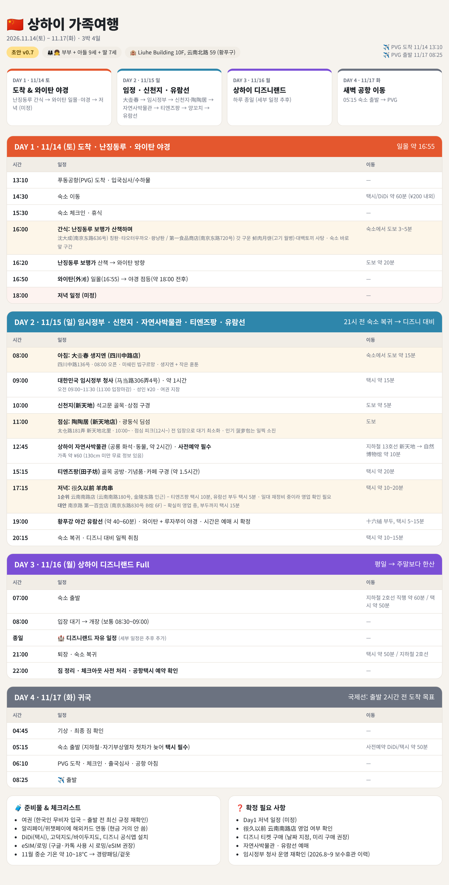

# 상하이 가족여행 (2026.11.14 ~ 11.17, 3박 4일) — 초안 v0.7

- 인원: 부부 + 아들 9세 + 딸 7세
- 숙소: Liuhe Building 10F, 59 Yunnan North Rd, 황푸구
- 항공: PVG 도착 11/14 13:10 · PVG 출발 11/17 08:25

| 일자 | 테마 | 주요 일정 |
|---|---|---|
| Day1 11/14(토) | 도착 & 야경 | 공항→숙소, 난징동루 간식(沈大成·第一食品), 와이탄 일몰·야경, 저녁(미정) |
| Day2 11/15(일) | 임정·신천지·유람선 | 아침 大壶春, 임시정부 청사, 신천지, 점심 陶陶居(新天地店), 자연사박물관, 티엔즈팡, 저녁 很久以前 양꼬치, 황푸강 유람선 |
| Day3 11/16(월) | 디즈니랜드 | 종일 자유 (세부 추후), 귀가 후 짐정리 |
| Day4 11/17(화) | 귀국 | 05:15 택시 출발 → PVG 08:25 |

상세 일정: `index.html` (브라우저로 열기)
