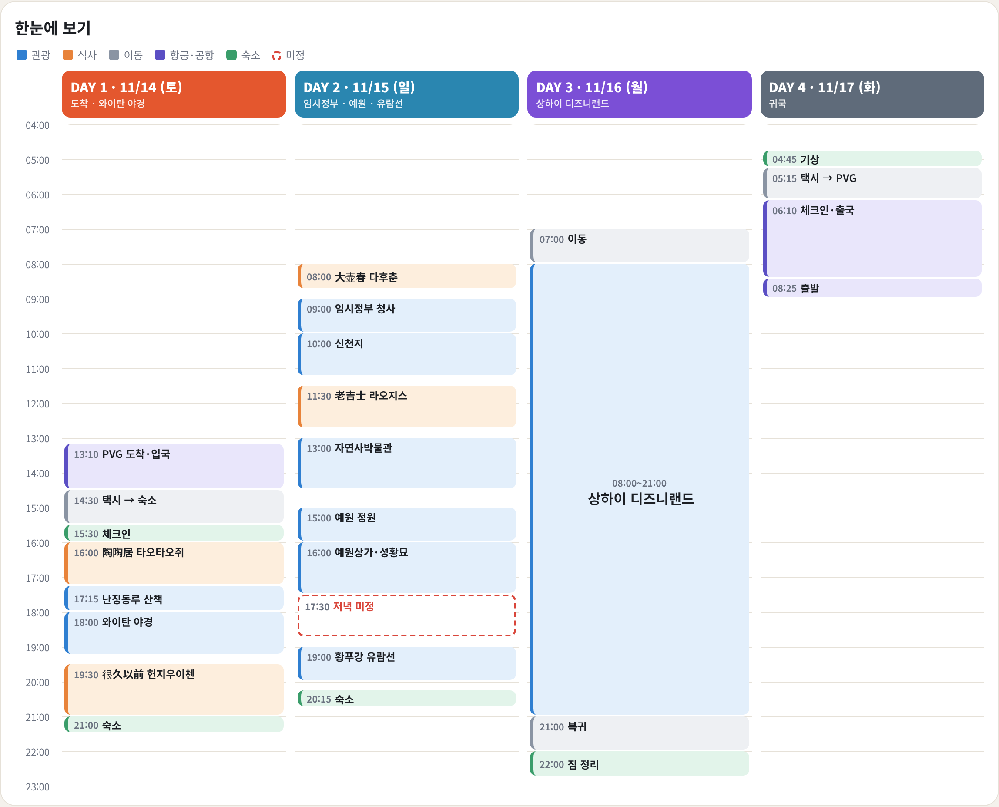

# 상하이 가족여행 (2026.11.14 ~ 11.17, 3박 4일) — v1.1

- 인원: 부부 + 아들 9세 + 딸 7세
- 숙소: Liuhe Building 10F, 59 Yunnan North Rd, 황푸구
- 항공: PVG 도착 11/14 13:10 · PVG 출발 11/17 08:25

## 한눈에 보기

## 상세 일정

| 일자 | 테마 | 주요 일정 |
|---|---|---|
| Day1 11/14(토) | 도착 & 야경 | 공항→숙소, 점심겸저녁 陶陶居(新世界城店), 난징동루, 와이탄 점등, 저녁 很久以前(第一百货店) |
| Day2 11/15(일) | 임정·예원·유람선 | 아침 大壶春, 임시정부 청사, 신천지, 점심 老吉士(兴业太古汇店), 자연사박물관, 예원·성황묘, 저녁(미정), 황푸강 유람선 |
| Day3 11/16(월) | 디즈니랜드 | 종일 자유 (세부 추후), 귀가 후 짐정리 |
| Day4 11/17(화) | 귀국 | 05:15 택시 출발 → PVG 08:25 |

상세 일정: `index.html` (브라우저로 열기)
